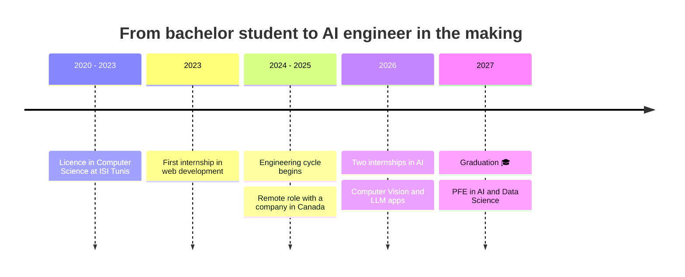

<div align="center">

<a href="https://github.com/siwarmrayhi">
  
</a>
<br/><br/>
 


 
</div>
---
 
## 💻 `whoami`
 
```bash
siwar@isi-tunis:~$ whoami
> Siwar Mrayhi, software engineering student with an AI obsession
 
siwar@isi-tunis:~$ cat mission.txt
> Turning data and models into products people can actually use.
 
siwar@isi-tunis:~$ ./status --now
> 🟢 Open to a final-year internship (PFE) in AI & Data Science
 
siwar@isi-tunis:~$ ./say_hi --to "you, the curious visitor"
> Thanks for stopping by. Scroll down, let's talk. 👇
```
 
---
 
## 🧬 My profile, as code
 
```python
class Siwar:
    def __init__(self):
        self.role      = "Software Engineering student @ ISI Tunis"
        self.degrees   = ["Licence in Computer Science (2023)",
                          "Engineering cycle, graduating 2027"]
        self.obsessed_with = ["Generative AI", "RAG", "AI agents",
                              "Computer Vision", "Data Science"]
        self.languages = {"Arabic": "native", "French": "B2", "English": "B2"}
        self.works     = "remotely, across borders, and in teams"
        self.status    = "Open to a PFE internship 🚀"
 
    def superpower(self):
        return "I bridge the gap between an AI idea and software people can use."
 
    def next_chapter(self):
        return "Your AI team, maybe? ✉️"
```
 
---
 
## 🛤️ The journey so far
 

 
---
 
## ⚡ What makes my profile different
 
<table>
<tr>
<td align="center" width="25%">
### 🧠
**AI + Software**<br/>
I'm not only training models, I know how to wrap them in APIs, containers and real interfaces.
 
</td>
<td align="center" width="25%">
### 📚
**LLMs & Agents**<br/>
I like making language models more reliable, grounded and useful with retrieval and orchestration.
 
</td>
<td align="center" width="25%">
### 👁️
**Machines that see**<br/>
Hands-on with computer vision, from detection to recognition and fraud resistance.
 
</td>
<td align="center" width="25%">
### 🌍
**Global mindset**<br/>
Remote work with an international team, three languages, and a habit of adapting fast.
 
</td>
</tr>
</table>
---
 
## 🛠️ My toolbox
 
<div align="center">
**🤖 AI & Data**
 

**🏗️ Build & Ship**
 

**🗄️ Data stores**
 


 
</div>
---
 
## 🎯 What I'm looking for
 
> **A final-year internship (PFE) in AI & Data Science**, ideally around **generative AI, RAG, AI agents or computer vision**, in a team where I can build things that go beyond the prototype.
 
If that sounds like your team, I'd love to talk. 🙌
 
---
 
## 🏅 Credentials
 
| | |
|---|---|
| 🎓 | Engineering cycle in Software Engineering, **ISI Tunis** (2024 – 2027) |
| 🎓 | Licence in Computer Science, **ISI Tunis** (2020 – 2023) |
| 🏅 | **Microsoft Azure AI Fundamentals** (AI-900), 2024 |
| 🏅 | **AI & Machine Learning Fundamentals**, CDOSS, 2025 |
 
---
 
## 📊 My GitHub in numbers
 
<div align="center">


<picture>
  <source media="(prefers-color-scheme: dark)" srcset="https://raw.githubusercontent.com/siwarmrayhi/siwarmrayhi/output/github-snake-dark.svg" />
  
</picture>
</div>
---
 
## 🤝 Let's build something together
 
<div align="center">
[](https://linkedin.com/in/siwar-mrayhi)
[](mailto:siwar.mrayhi@etudiant-isi.utm.tn)
<!-- Once your portfolio is online, uncomment and replace the URL:
[](https://YOUR-PORTFOLIO-URL)
-->
 
<br/>
*"The best way to predict the future is to build it."* ✨
 

</div>
 
