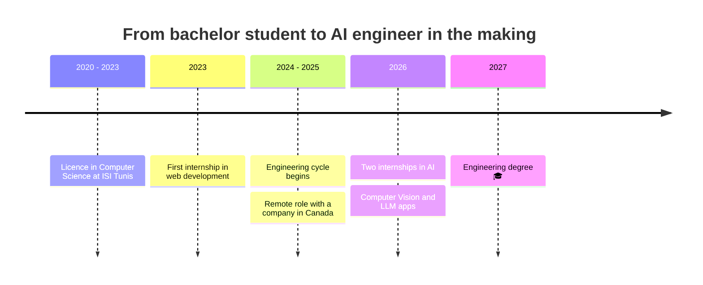

<div align="center">


<a href="https://github.com/siwarmrayhi">
  
</a>

<br/><br/>


</div>

---

## 💻 `whoami`

```bash
siwar@isi-tunis:~$ whoami
> Siwar Mrayhi, software engineering student with an AI obsession

siwar@isi-tunis:~$ cat mission.txt
> Turning data and models into products people can actually use.

siwar@isi-tunis:~$ ./status --now
> 🟢 Learning, building, shipping. Always.

siwar@isi-tunis:~$ ./say_hi --to "you, the curious visitor"
> Thanks for stopping by. Have a look around. 👇
```

---

## 🧬 My profile, as code

```python
class Siwar:
    def __init__(self):
        self.role      = "Software Engineering student @ ISI Tunis"
        self.degrees   = ["Licence in Computer Science (2023)",
                          "Engineering cycle, graduating 2027"]
        self.obsessed_with = ["Generative AI", "RAG", "AI agents",
                              "Computer Vision", "Data Science"]
        self.languages = {"Arabic": "native", "French": "B2", "English": "B2"}
        self.works     = "remotely, across borders, and in teams"

    def superpower(self):
        return "I bridge the gap between an AI idea and software people can use."

    def motto(self):
        return "Build things that matter."
```

---

## 🛤️ The journey so far



---

## ⚡ What makes my profile different

<table align="center">
  <tr>
    <td align="center" width="25%" valign="top">
      <h3>🧠</h3>
      <b>AI + Software</b><br/><br/>
      I'm not only training models, I know how to wrap them in APIs, containers and real interfaces.
    </td>
    <td align="center" width="25%" valign="top">
      <h3>📚</h3>
      <b>LLMs &amp; Agents</b><br/><br/>
      I like making language models more reliable, grounded and useful with retrieval and orchestration.
    </td>
    <td align="center" width="25%" valign="top">
      <h3>👁️</h3>
      <b>Machines that see</b><br/><br/>
      Hands-on with computer vision, from detection to recognition and fraud resistance.
    </td>
    <td align="center" width="25%" valign="top">
      <h3>🌍</h3>
      <b>Global mindset</b><br/><br/>
      Remote work with an international team, three languages, and a habit of adapting fast.
    </td>
  </tr>
</table>

---

## 🛠️ My toolbox

<table align="center">
  <tr>
    <td><b>🧠 Machine Learning &amp; Data</b></td>
    <td></td>
  </tr>
  <tr>
    <td><b>📚 LLMs &amp; Agents</b></td>
    <td>
      
      
      
      
    </td>
  </tr>
  <tr>
    <td><b>👁️ Computer Vision</b></td>
    <td>
      
      
    </td>
  </tr>
  <tr>
    <td><b>🏗️ Backend &amp; Frontend</b></td>
    <td></td>
  </tr>
  <tr>
    <td><b>🗄️ Databases</b></td>
    <td></td>
  </tr>
  <tr>
    <td><b>🚀 DevOps &amp; Tools</b></td>
    <td></td>
  </tr>
</table>

---

## 🏅 Credentials

<table align="center">
  <tr>
    <td>🎓</td>
    <td>Engineering cycle in Software Engineering, <b>ISI Tunis</b> (2024 – 2027)</td>
  </tr>
  <tr>
    <td>🎓</td>
    <td>Licence in Computer Science, <b>ISI Tunis</b> (2020 – 2023)</td>
  </tr>
  <tr>
    <td>🏅</td>
    <td><b>Microsoft Azure AI Fundamentals</b> (AI-900), 2024</td>
  </tr>
  <tr>
    <td>🏅</td>
    <td><b>AI &amp; Machine Learning Fundamentals</b>, CDOSS, 2025</td>
  </tr>
</table>

---

## 📊 My GitHub in numbers

<div align="center">


<br/>


<br/>


<br/>

<picture>
  <source media="(prefers-color-scheme: dark)" srcset="https://raw.githubusercontent.com/siwarmrayhi/siwarmrayhi/output/github-snake-dark.svg" />
  
</picture>

</div>

---

## 🤝 Let's connect

<div align="center">

<a href="https://linkedin.com/in/siwar-mrayhi"></a>
<a href="mailto:siwar.mrayhi@etudiant-isi.utm.tn"></a>
<!-- Once your portfolio is online, uncomment and replace the URL:
<a href="https://YOUR-PORTFOLIO-URL"></a>
-->

<br/><br/>

<i>"The best way to predict the future is to build it."</i> ✨


</div>
